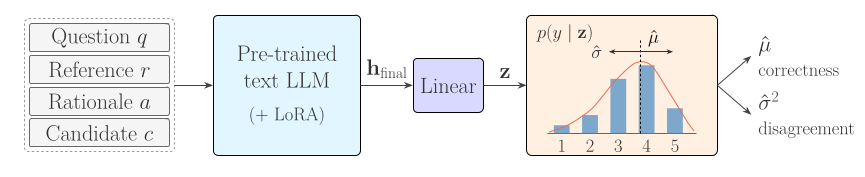
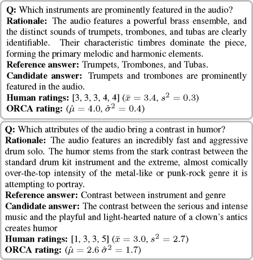

# ORCA: Open-ended Response Correctness Assessment for Audio Question Answering

Rate how correct an answer to an audio question is, as a human annotator would. ORCA predicts the
average human rating and the annotators' disagreement for each answer.

[Paper](https://doi.org/10.1162/TACL.a.798) (TACL 2026) &nbsp;·&nbsp;
[Dataset](https://huggingface.co/datasets/BUT-FIT/orca-audio-qa-annotations) &nbsp;·&nbsp;
[Models](https://huggingface.co/BUT-FIT) &nbsp;·&nbsp;
[Code](https://github.com/BUTSpeechFIT/ORCA)



ORCA models reach a Spearman correlation of 0.91 with average human ratings on seen benchmarks and
0.85 on unseen ones, outperforming several LLM judges including Gemini 2.5 Flash.

## Installation

Python 3.12 or newer.

```bash
pip install orca-score            # scoring
pip install "orca-score[train]"   # also training
```

From a clone of this repository: `pip install -e .`

With [uv](https://docs.astral.sh/uv/):

```bash
uv venv --python 3.12 && source .venv/bin/activate
uv pip install -e . --group dev
```

## Answer correctness assessment (scoring)

```bash
orca-score --model gemma-4b --input my_data.jsonl --output scored.jsonl  # our pre-trained model on your data
```
```bash
orca-score --model gemma-4b --input mmau-pro  # our pre-trained model on our human-rated test set
```

```bash
orca-score --model /path/to/model_dir --input my_data.jsonl --var_threshold 0.05   # your model on your data
```

`--model` takes a published ORCA model (`gemma-4b`, `llama-3b`, `olmo-1b`) or a trained ORCA model
ready for scoring: a local directory that contains `model/` and `tokenizer/`, for example a training
checkpoint `.../best`.

There is no default model: always pass `--model`. Published models are downloaded from Hugging Face
on first use, together with their base language model (for example Gemma), which may require
accepting its license. `orca-score --download gemma-4b` fetches them in advance, and
`orca-score --list` shows what is available.

**Input:** JSONL, one object per line.

| field | |
|---|---|
| `question`, `reference`, `candidate` | required: the question, the correct answer, the answer to judge |
| `context` | optional: a rationale and/or a transcript for the judge (`rationale` is accepted as another name); `--skip_context` ignores it |
| `id` | optional: label copied to the output (need not be unique) |
| `ratings` | optional: human ratings (1-5); if every row has them, Spearman, Kendall and MAE are reported |

**Output:** JSONL with the input fields plus

| field | |
|---|---|
| `orca_score` | predicted correctness, 0 to 1 |
| `orca_variance` | predicted disagreement among human annotators: the variance of the ratings they would give, on the same 0-1 scale as `orca_score`. Higher means more disagreement, so the question or reference is likely subjective or ambiguous |
| `orca_score_clamped` | `orca_score` with confident, extreme scores set to 0 or 1 (see below); only written if a threshold is available |
| `orca_model` | the model that produced the scores: name, date its files were last updated on Hugging Face, and commit (`olmo-1b, updated 2026-06-30 (ad2a16b3)`); `local: <dir>` for a local model |

`orca_variance` is only meaningful for models fine-tuned on human ratings (stage 3); models trained
only on stages 1 and 2 do not predict disagreement well.

**Clamping (`orca_score_clamped`):** a score below 0.125 or above 0.875 is set to 0 or 1 when its
predicted variance (0-1 scale) is at most the clamping threshold; all other scores are unchanged
(`orca_score/clamp.py`). Published models come with a fixed threshold. For your own trained model
pass `--var_threshold`; without it only `orca_score` and `orca_variance` are written.

**Python:**

```python
from orca_score.scorer import OrcaScorer, score

score(question="...", reference="...", candidate="...", context="...", model="gemma-4b")   # context optional

scorer = OrcaScorer("gemma-4b")    # the model is always given; or OrcaScorer("/path/to/model_dir", var_threshold=0.05)
scorer.score_many([{"question": "...", "reference": "...", "candidate": "..."}])
```

Both return the output fields above (`orca_score_clamped` is `None` without a threshold).

## Models, data and benchmarks

**Published ORCA models (ready for scoring):**
- [orca-gemma-3-4b-it-multinomial](https://huggingface.co/BUT-FIT/orca-gemma-3-4b-it-multinomial)
- [orca-llama-3.2-3b-it-multinomial](https://huggingface.co/BUT-FIT/orca-llama-3.2-3b-it-multinomial)
- [orca-olmo-2-1b-multinomial](https://huggingface.co/BUT-FIT/orca-olmo-2-1b-multinomial)

**Dataset:** [BUT-FIT/orca-audio-qa-annotations](https://huggingface.co/datasets/BUT-FIT/orca-audio-qa-annotations)

**Corrected benchmarks:** the **corrected and rephrased** [MMAU and MMAR benchmarks](https://github.com/BUTSpeechFIT/ORCA/blob/main/benchmarks/README.md)
can be used for open-ended evaluation.

## Training

```bash
orca-train \
    --train_data train.jsonl --val_data dev.jsonl \
    --model allenai/OLMo-2-0425-1B-Instruct \
    --score_type multinomial --lora_rank 128 \
    --output_dir output/
```

- **Data:** [BUT-FIT/orca-audio-qa-annotations](https://huggingface.co/datasets/BUT-FIT/orca-audio-qa-annotations)
  holds the training and test data pooled by stage (s1, s2, s3).
  The stratified splits for `s2-mmau-mmar-llm-judge-ratings.jsonl` and `s3-mmau-mmar-human-judge-ratings.jsonl` used for experiments reported in the paper are not included here. Contact us incase you need them.
- **Curriculum:** train on `s1-synthetic-qa-ratings.jsonl`, `s2-mmau-mmar-llm-judge-ratings.jsonl`,
  then `s3-mmau-mmar-human-judge-ratings.jsonl`, passing `--load_checkpoint <previous output_dir>/best`
  between stages.
- **Rationale dropout:** `--rationale_dropout P` drops the rationale of a training sample with probability `P`.
- All options: `orca-train --help`.

## About the paper



**Abstract:** Reliable assessment of the abilities of large audio language models (LALMs) is essential to advancing the state of the art. As benchmarks rapidly evolve to incorporate complex reasoning and subjective tasks, they increasingly necessitate open-ended responses from LALMs. We present Open-ended Response Correctness Assessment (ORCA) — a reliable and lightweight model-based approach for answer correctness and disagreement modeling. We employ a three-stage annotation pipeline combining human judgment, structured feedback, and human-AI correction, yielding 9,663 annotations across 3,699 question-answer pairs from 15 LALMs on three audio understanding and reasoning benchmarks (achieving a Krippendorff's alpha of 0.82). Our experiments employing curriculum learning show that ORCA models achieve a Spearman correlation of 0.91 with average human correctness ratings on seen benchmarks and generalize to unseen benchmarks with a score of 0.85, outperforming several LLM judge baselines including Gemini 2.5 Flash. Furthermore, we demonstrate that ORCA's predicted variance correlates strongly with human disagreement, allowing it to effectively identify problematic benchmark items.

**Authors:** Šimon Sedláček¹, Sara Barahona², Cecilia Bolaños³, Laura Herrera-Alarcón², Sathvik Udupa¹, Fernando López², Allison Ferner⁴, Alicia Lozano-Diez², Bolaji Yusuf¹, Santosh Kesiraju¹, Ramani Duraiswami⁵, Jan Černocký¹

¹Speech@FIT, Brno University of Technology, Czechia &nbsp;·&nbsp;
²Universidad Autónoma de Madrid, Spain &nbsp;·&nbsp;
³University of Buenos Aires, Argentina &nbsp;·&nbsp;
⁴Tufts University, USA &nbsp;·&nbsp;
⁵University of Maryland, USA

Paper: [https://doi.org/10.1162/TACL.a.798](https://doi.org/10.1162/TACL.a.798), accepted to *Transactions of the ACL 2026*.

## Citation

```bibtex
@article{sedlacek-etal-2026-orca,
    author = {Sedláček, Šimon and Barahona, Sara and Bolaños, Cecilia and Herrera-Alarcón, Laura and Udupa, Sathvik and López, Fernando and Ferner, Allison and Yusuf, Bolaji and Lozano-Diez, Alicia and Kesiraju, Santosh and Duraiswami, Ramani and Černocký, Jan},
    title = "{ORCA: Open-ended Response Correctness Assessment for Audio Question Answering}",
    journal = {Transactions of the Association for Computational Linguistics},
    volume = {14},
    pages = {2213-2233},
    year = {2026},
    month = {08},
    issn = {2307-387X},
    doi = {10.1162/TACL.a.798},
    url = {https://doi.org/10.1162/TACL.a.798},
    eprint = {https://direct.mit.edu/tacl/article-pdf/doi/10.1162/TACL.a.798/2624638/tacl.a.798.pdf},
}
```

## License and contact

MIT License, see [LICENSE](https://github.com/BUTSpeechFIT/ORCA/blob/main/LICENSE).
Contact: Šimon Sedláček (isedlacek@fit.vut.cz), Bolaji Yusuf (iyusuf@fit.vut.cz), Santosh Kesiraju (kesiraju@fit.vut.cz).
